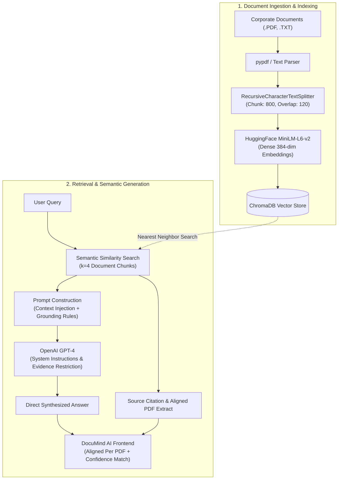

# DocuMind AI — Enterprise Document Intelligence Platform

[](https://react.dev/)
[](https://vite.dev/)
[](https://fastapi.tiangolo.com/)
[](https://www.trychroma.com/)
[](https://www.langchain.com/)
[](https://openai.com/)
[](LICENSE)

An enterprise-grade **Retrieval-Augmented Generation (RAG)** platform designed to transform corporate manuals, security policies, and technical documentation into a verified, source-grounded intelligent assistant.

---

## 🌟 Key Highlights & Capabilities

- 📄 **Source-Grounded Semantic RAG**: Ingests multi-page PDFs and text files, splits them into semantic chunks using `RecursiveCharacterTextSplitter`, and indexes dense 384-dimensional vector embeddings into **ChromaDB**.
- 📑 **Answers Aligned Per PDF / Document**: Synthesized answers are automatically broken down and categorized by document with clickable filter tabs, exact page citations, bulleted findings, and verbatim quotation excerpts.
- 🎯 **Semantic Match Confidence**: Displays vector relevance confidence scores (e.g., `98% match`) for each cited document section.
- 🛡️ **Anti-Hallucination Guardrails**: Detects out-of-scope or unverified inquiries and explicitly informs the user with a **"Not found in indexed documents"** warning and relevant suggested questions, rather than fabricating answers.
- 🔄 **Dual-Mode Architecture**:
  - **Standalone Mode (Zero Setup)**: Operates out of the box with sample enterprise policy documents and instant intelligent answers without requiring an active backend or API key.
  - **Live API Mode**: Automatically detects and connects to the FastAPI backend at `http://127.0.0.1:8000` via live `/health` probing.
- 🔍 **Knowledge Base & Chunk Inspector**: Full management dashboard to inspect indexed documents, view page counts, file sizes, token counts, and inspect raw vector chunks with metadata.
- 🎙️ **Voice Query Dictation**: Browser-native Speech-to-Text dictation to speak inquiries hands-free.
- 📋 **One-Click Answer Copying**: Instant clipboard copy with visual confirmation.
- 📥 **Export Intelligence Reports**: One-click export of complete question-and-answer transcripts with citations to structured Markdown (`DocuMind_Intelligence_Report.md`).
- 💬 **Conversation History & Settings**: Switch between past inquiry threads, adjust chunk size (400–1600 tokens), chunk overlap (50–300 tokens), language models (`gpt-4.1-mini`, `gpt-4o`), and test backend connectivity.

---

## 🏗️ Architecture & Pipeline



---

## 📁 Repository Structure

```text
Enterprise Document Intelligence Platform/
├── documind-ai/
│   ├── backend/                     # FastAPI & RAG Backend
│   │   ├── main.py                  # API routes (/upload, /chat, /health)
│   │   ├── requirements.txt         # Python backend dependencies
│   │   ├── .env.example             # Template for API keys
│   │   └── data/                    # ChromaDB persistent vector storage
│   └── frontend/                    # Modern React 19 Frontend
│       ├── public/                  # Favicons and public assets
│       ├── src/
│       │   ├── App.jsx              # Main application & interactive views
│       │   ├── App.css              # Custom responsive stylesheet
│       │   ├── index.css            # Typography & system reset
│       │   └── main.jsx             # React DOM entrypoint
│       ├── index.html               # HTML template & Google Fonts
│       ├── package.json             # NPM scripts & dependencies
│       └── vite.config.js           # Vite bundler configuration
├── requirements.txt                 # Root Python dependencies
├── .gitignore                       # Git exclusion rules (protects .env & builds)
└── README.md                        # Documentation
```

---

## 🚀 Quickstart Guide

### Prerequisites
- **Node.js**: v18.0.0 or higher ([Download](https://nodejs.org/))
- **Python**: v3.10 or higher ([Download](https://www.python.org/))
- **OpenAI API Key**: (Optional for Standalone demo; required for Live API mode)

---

### Step 1: Run the Frontend (Instant Standalone Demo)

```bash
# 1. Navigate to frontend directory
cd "documind-ai/frontend"

# 2. Install dependencies
npm install

# 3. Start development server
npm run dev
```

Open **`http://localhost:5173`** in your browser. The platform will automatically load with the demo knowledge base and ready-to-test inquiry questions.

---

### Step 2: (Optional) Run the FastAPI & ChromaDB Backend

To enable real document uploads and OpenAI vector semantic retrieval:

```bash
# 1. Navigate to backend directory
cd "documind-ai/backend"

# 2. Create and activate a Python virtual environment
python -m venv .venv

# Windows (PowerShell):
.venv\Scripts\Activate.ps1
# macOS / Linux:
source .venv/bin/activate

# 3. Install backend dependencies
pip install -r requirements.txt

# 4. Configure environment variables
# Copy .env.example to .env and insert your OpenAI API key:
cp .env.example .env
```

Edit `.env`:
```ini
OPENAI_API_KEY="sk-your-openai-api-key-here"
OPENAI_MODEL="gpt-4.1-mini"
```

```bash
# 5. Start the FastAPI server
uvicorn main:app --reload --port 8000
```

The frontend will automatically detect the backend on port `8000` via its `/health` probe and switch to **Live API** mode.

---

## 🔌 API Reference

### 1. Health Check
```http
GET http://127.0.0.1:8000/health
```
**Response:**
```json
{
  "status": "ok",
  "application": "DocuMind AI",
  "message": "Backend is running"
}
```

### 2. Document Upload & Chunking
```http
POST http://127.0.0.1:8000/upload
Content-Type: multipart/form-data
```
Uploads `.pdf` or `.txt` files, extracts textual content, splits into chunks, and stores embeddings into ChromaDB.

**Response:**
```json
{
  "message": "Documents indexed successfully.",
  "files": ["Security Policy.pdf"],
  "pages_with_text": 9,
  "chunks_created": 12
}
```

### 3. Source-Grounded Chat Query
```http
POST http://127.0.0.1:8000/chat
Content-Type: application/json

{
  "question": "What are the password requirements?"
}
```
**Response:**
```json
{
  "answer": "Corporate passwords must be at least 14 characters in length and rotated every 90 days with mandatory MFA [Source 1].",
  "sources": [
    {
      "source": "Security Policy.pdf",
      "page": 2,
      "excerpt": "All enterprise accounts must implement strong authentication..."
    }
  ]
}
```

---

## 🤝 Contributing

Contributions, issues, and feature requests are welcome!

1. Fork the project (`https://github.com/Dhanushree08/DocuMind-AI/fork`)
2. Create your feature branch (`git checkout -b feature/AmazingFeature`)
3. Commit your changes (`git commit -m "feat: Add some AmazingFeature"`)
4. Push to the branch (`git push origin feature/AmazingFeature`)
5. Open a Pull Request

---

## 🛡️ License

This project is licensed under the [MIT License](LICENSE).
